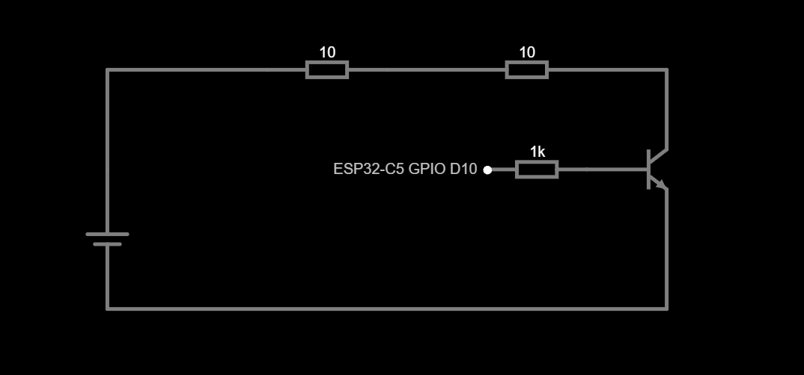

# 🎄 ESP32 Christmas Star

Turning an ordinary battery-powered Christmas decoration into a smart, programmable device using an ESP32-C5.

## 📖 About the Project

This project explores how a simple Christmas decoration can be upgraded using modern microcontroller technology.

The goal is to develop a compact, programmable and eventually rechargeable Christmas star.

This repository documents the entire development process, including experiments, measurements, mistakes and improvements.

## 🎬 YouTube Series

### Episode 01 – Building the Prototype

- Analyzing the original decoration
- Measuring current consumption
- Designing the circuit using Falstad
- Building a breadboard prototype
- AI-assisted ESP32 programming
- Testing the first prototype

YouTube video coming soon.

## 🔧 Hardware

- ESP32-C5 development board
- LED Christmas star
- Transistor
- Resistors
- Breadboard
- Jumper wires
- USB-C power supply

## ⚡ Circuit Diagram

The circuit was designed using the Falstad Circuit Simulator.

### Circuit Files

- [Download Falstad Circuit](schematics/circuit.txt)
- [View Circuit Diagram](schematics/circuit.png)
- [Open Falstad Simulator](https://www.falstad.com/circuit/)

### Circuit Overview

- Supply voltage: 3.3 V
- Current-limiting resistors: 2 × 10 Ω
- Total series resistance: 20 Ω
- Base resistor: 1 kΩ
- NPN transistor SS8050 for switching
- ESP32-C5 GPIO 10 as control signal

## 💻 Firmware

The firmware is written in MicroPython and was developed with AI assistance.

[View Source Code – main.py](firmware/main.py)

### Installation

1. Install compatible MicroPython firmware on your ESP32-C5.
2. Connect the ESP32-C5 to your computer via USB.
3. Open a MicroPython-compatible IDE.
4. Upload `main.py` to the ESP32-C5.
5. Restart the microcontroller.
6. Test the connected Christmas star.

The current firmware is intended for the first breadboard prototype.

## 🗺️ Roadmap

- [x] Analyze original decoration
- [x] Measure current consumption
- [x] Design prototype circuit
- [x] Build breadboard prototype
- [x] Develop initial firmware
- [x] Test first prototype
- [ ] Publish firmware and circuit diagram
- [ ] Optimize power consumption
- [ ] Integrate rechargeable LiPo battery
- [ ] Design custom 3D-printed enclosure
- [ ] Build final version

## 📄 License

This project is licensed under the MIT License.

## 👨‍💻 About TechniGuide

Electronics, engineering, programming and DIY projects.

Building things, making mistakes and learning along the way.

---

Made by **TechniGuide**
